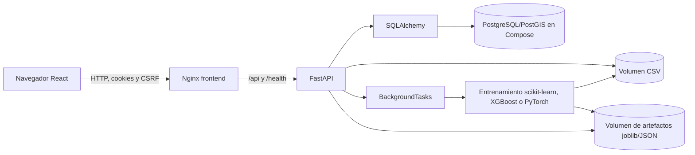
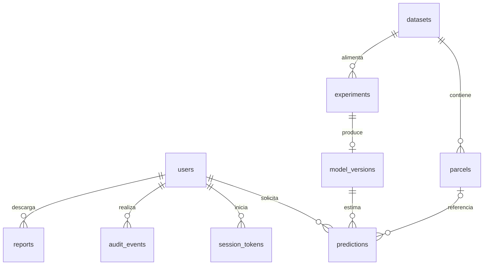

# Arquitectura implementada

La aplicación consta de React/TypeScript servido por Nginx, FastAPI y SQLAlchemy. `compose.yaml` añade PostgreSQL sobre la imagen PostGIS y tres volúmenes persistentes: base de datos, CSV importados y artefactos de modelos. La migración crea una geometría PostGIS `Point` generada a partir de latitud/longitud y un índice GiST; la aplicación aún no ejecuta consultas espaciales ni guarda polígonos de parcela. En desarrollo, `DATABASE_URL` puede usar SQLite sin esa columna PostGIS. Las migraciones residen en `backend/alembic/versions/`: `0001_initial.py` y `0002_sessions.py` para actualizar bases existentes con control de sesión.

En esta versión, las tareas de entrenamiento se ejecutan en el proceso de FastAPI mediante `BackgroundTasks`. Los estados están en la base de datos, pero no existe una cola persistente ni recuperación automática de una tarea interrumpida al reiniciar el contenedor. El límite de dos tareas se comprueba en la API. Los reportes PDF, DOCX y XLSX se generan al solicitarlos a partir de registros persistidos.

## Modelo de datos

`users` guarda rol (`admin`, `researcher`, `analyst`, `viewer`) y hash de contraseña. `session_tokens` registra el identificador `jti` y su revocación. `datasets` guarda origen, licencia declarada, marcador `synthetic`, archivo CSV y resumen de calidad. `parcels` conserva el identificador externo y campaña, cultivo, región, país opcional, coordenadas opcionales y rendimiento observado. `experiments` guarda estado, validación, semilla, avance, logs, partición y métricas. `model_versions` apunta a un artefacto local y registra características, métricas, origen sintético y aprobación. `predictions` guarda modelo, usuario, entradas, rendimiento en t/ha, advertencias y origen. `audit_events` y `reports` registran actividad.

Las características de observaciones se conservan en el CSV, no en una tabla normalizada de series temporales. La ubicación actual de parcelas es un punto opcional, no un polígono ni una capa de predicción por píxel. Esto limita el análisis geoespacial y los modelos espaciales. El asistente local responde mediante consultas estructuradas a datasets y modelos; no usa generación ni recuperación documental. No se ha conectado MinIO, MLflow, Redis/Celery, n8n, LangChain ni LangFlow; sus usos potenciales están descritos en el [estado de implementación](../IMPLEMENTATION_STATUS.md).

## Límites de confianza y datos

FastAPI verifica sesión y roles antes de operaciones protegidas. La cookie de sesión contiene un JWT firmado; la cookie CSRF y la cabecera correspondiente protegen métodos de escritura autenticados. Los CSV y artefactos quedan en volúmenes privados del backend. El origen `synthetic` se propaga del dataset al modelo y la predicción para no presentar la demostración como evaluación científica. Consulte [Seguridad](SECURITY.md) y [Pipeline](ML_PIPELINE.md) para los detalles.
