# Pipeline de datos y modelos

Este documento traduce el protocolo de [`tema (2).docx`](<../tema (2).docx>), fuente científica principal, en reglas reproducibles para comparar modelos de rendimiento. La implementación y las ejecuciones verificadas se registran por separado en [IMPLEMENTATION_STATUS.md](../IMPLEMENTATION_STATUS.md); una arquitectura descrita aquí no significa que haya sido entrenada.

El vacío identificado en el documento es que muchos trabajos emplean clima o satélite por separado. La hipótesis de integrar fuentes y validar por geografía y tiempo solo puede comprobarse comparando modalidades en particiones independientes. Ya se ejecutaron evaluaciones temporal y por regiones reservadas con la muestra regional de CY-Bench, documentadas en [CYBENCH.md](CYBENCH.md); no se ha demostrado mejora debida a fusión ni transferencia a Perú.

## Unidad de análisis y objetivo

La evaluación ejecutada usa **región administrativa y año** de CY-Bench como unidad, con rendimiento observado en **t/ha**. El campo histórico `parcel_id` contiene el identificador NUTS y `spatial_unit=administrative_region` impide presentarlo como una parcela. YieldSAT, si se obtiene, ofrece observaciones por píxel vinculadas a una parcela; esas métricas requerirían una tabla separada. [Fuente CY-Bench](https://doi.org/10.5194/essd-18-3997-2026), [tutorial YieldSAT](https://yieldsat.github.io/notebooks/yieldsat-ml-tutorial.html).

## Flujo reproducible

```mermaid
flowchart LR
  A[Archivo autorizado o datos propios] --> B[Inventario y huellas SHA-256]
  B --> C[Validación de esquema y calidad]
  C --> D[Partición por unidad espacial, campaña, región o tiempo]
  D --> E[Transformaciones ajustadas solo con entrenamiento]
  E --> F[Entrenamiento y ajuste interno]
  F --> G[Evaluación en prueba sellada]
  G --> H[Registro de artefactos y métricas]
  H --> I[Modelo versionado e inferencia compatible]
```



1. Abrir el dataset sin leerlo completo en RAM. Inventariar variables, dimensiones, códigos de atributos, grupos, fechas y versión.
2. Rechazar objetivos ausentes, no finitos o de unidad desconocida. Documentar reglas de limpieza y cantidades descartadas por regla y por grupo. La imputación de características se aprende exclusivamente en entrenamiento.
3. Aplicar máscaras de nubes y derivar NDVI, EVI o NDWI solo cuando se disponga de bandas válidas y datos de reflectancia adecuados. En el NetCDF fusionado, verificar nombres y escalas antes de calcular índices; si faltan bandas, registrar la ausencia.
4. Dividir **antes** de normalizar o seleccionar características. Mantener todos los píxeles de una misma parcela en el mismo conjunto. Para medir transferencia, evaluar además una campaña futura (LOYO) y una región/granja no vista (LORO) cuando existan grupos suficientes. Estas pruebas responden a los cambios de distribución que documentan los autores de [YieldSAT](https://yieldsat.github.io/).
5. Guardar semilla, hashes de entradas, código, configuración, versión de dependencias, grupos asignados a cada partición, transformadores, parámetros, métricas y artefactos. Si se usa Optuna, sus ensayos solo usan entrenamiento y validación interna.
6. Evaluar con MAE, RMSE y R² en t/ha; MAPE solo si no hay objetivos cero o cercanos a cero y se documenta el umbral. Calcular desgloses por cultivo, país/región y campaña cuando hay soporte muestral. Mostrar dispersión observado/predicho y residuos. Los intervalos de confianza deben señalar método, unidad de remuestreo y cobertura.

### Adaptación real de CY-Bench

`backend/app/ml/cybench.py` descarga la muestra pública fijada y une etiquetas regionales de maíz español con calendario, suelo, meteorología, humedad, NDVI y fPAR. El horizonte termina a mitad de temporada; las fechas posteriores y las columnas `production`/`harvest_area` no entran al modelo. El CSV resultante contiene cuatro pasos temporales por variable y un manifiesto de procedencia. La opción `validation=temporal` asigna los años más antiguos a entrenamiento, los siguientes a validación y los últimos a prueba; los transformadores se ajustan solo en entrenamiento. Se probaron los cinco modelos con la misma partición 2003–2013/2014–2016/2017–2020. Una segunda ejecución con `validation=parcel` reservó 10 códigos NUTS completos; en este dataset el identificador histórico `parcel_id` es una región. [Datos, protocolo y métricas](CYBENCH.md).

### Adaptación local del NetCDF preprocesado

La CLI `python -m app.ml` implementa `discover`, `inspect` y `convert` para NetCDF YieldSAT **ML-ready** disponible localmente. `convert` requiere `--max-samples` y procesa segmentos de `index` por lotes; genera un CSV por píxel con 24 pasos temporales según el archivo, objetivo en t/ha, `parcel_id` compuesto de país/granja/parcela y un manifiesto `.provenance.json` con SHA-256, unidad y rango. Si falta `region`, usa país y registra esa granularidad. La conversión fue probada con un fixture sintético de dos tiempos, no con el dataset YieldSAT real. [Comandos y límites](DATASETS.md#adaptador-local-netcdf--csv).

El subconjunto convertido por `--start` y `--max-samples` es **contiguo** y no debe considerarse representativo de países, cultivos o parcelas. Las fechas de adquisición por muestra no pasan al CSV aunque se conserve el orden temporal; si se necesita fenología con fechas exactas, hay que ampliar la transformación. La CLI no registra el CSV en la base. La subida web limita los CSV a 20 MB; para una exportación mayor, la ejecución local del pipeline requiere una estrategia de ingestión y memoria apropiada.

## Familias comparables

| Modelo | Entrada apropiada | Requisito antes de evaluar |
| --- | --- | --- |
| Random Forest | Características resumidas de la serie y modalidades estáticas. | Definir agregaciones temporales sin información posterior al momento de predicción. |
| XGBoost | Mismas características tabulares y particiones que Random Forest. | Guardar preprocesador y nombres/orden de características. |
| LSTM | Secuencia de 24 pasos más modalidades compatibles. | Mantener máscaras de faltantes y orden temporal. |
| CNN-LSTM | Parches espaciales ordenados en el tiempo. | El NetCDF por píxel aplanado no conserva un parche listo para el modelo; reconstruirlo con `row`, `col`, parcela y mascaramiento, o usar los rasters por parcela. |
| CNN-Transformer multimodal | Parches, secuencia y ramas auxiliares. | Definir fusión y máscara de modalidad faltante; verificar alineamiento espacial y temporal. |

El [notebook de exploración](https://yieldsat.github.io/notebooks/yieldsat-overview-notebook.html) muestra cómo reconstruir una parcela a partir de `field_shared_name`, `row` y `col`. El [benchmark de los autores](https://yieldsat.github.io/) evalúa LSTM y arquitecturas espaciotemporales en CV10, LORO y LOYO. Sus cifras son referencias externas; nunca deben aparecer como métricas producidas por este proyecto.

## Interpretación y límites

Para Random Forest y XGBoost, la API ya publica `model_feature_importances` global por característica transformada y etiqueta `causal: false`. Esta magnitud del estimador no es SHAP y puede favorecer ciertas variables; no debe interpretarse como efecto causal. SHAP sigue pendiente. Para redes, todavía no se expone un método de importancia; su endpoint responde `501`. Ninguna salida para Perú se presenta como validada hasta contar con rendimiento local observado y una evaluación separada. El sistema debe advertir sobre cultivos, países y rangos de características fuera del dominio de entrenamiento.

## Perfiles de ejecución

Un perfil ligero puede usar un subconjunto explícito y reproducible de parcelas para verificar el flujo con CPU; el resultado debe llevar `synthetic` o `subset` según corresponda. El perfil completo usa todos los datos autorizados y reporta recursos, duración y fallos. La viabilidad de CNN-LSTM y CNN-Transformer depende de memoria, capacidad de cómputo y disponibilidad de archivos espaciales. No confundir que el código de un modelo exista con que haya sido entrenado o validado.

Para repetir localmente un entrenamiento tabular de demostración, con las dependencias de `backend/requirements.txt` instaladas y desde la raíz del proyecto:

```powershell
$env:PYTHONPATH = (Join-Path (Get-Location) 'backend')
python -c "from app.ml import create_demo_csv, train; p=create_demo_csv('data/demo-local.csv', seed=42); r=train(p, 'RandomForest', 'artifacts', seed=42, validation='parcel'); print(r['metrics'])"
```

El comando crea datos **sintéticos** y guarda `joblib` y JSON localmente. Para probar LSTM, CNN-LSTM o CNN-Transformer por esta vía, instale además `backend/ml-requirements.txt` y cambie el nombre de modelo; el CSV debe contener secuencias temporales compatibles. En Compose, establezca `INSTALL_TORCH=true` antes de reconstruir para incluir PyTorch CPU. Para datos reales, sustituya el CSV y registre su autorización, hash y unidades; el comando de demo no produce un resultado científico.
