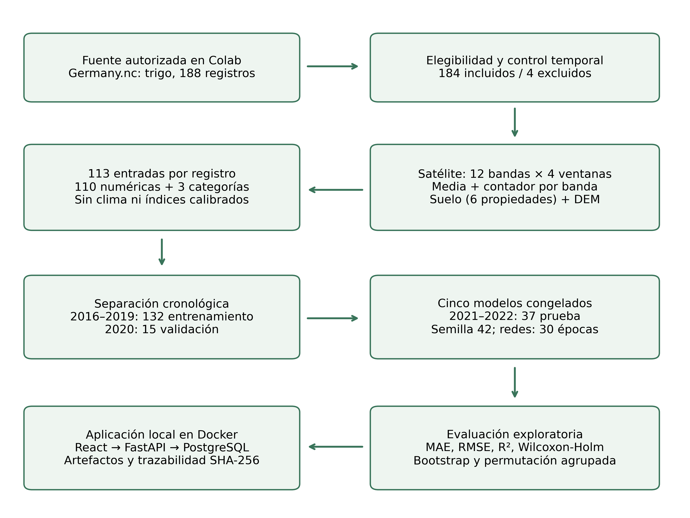
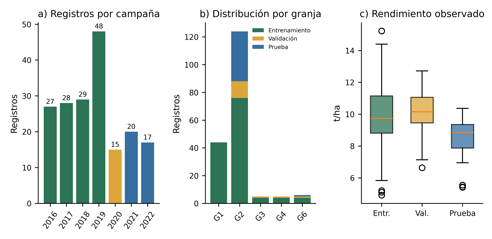
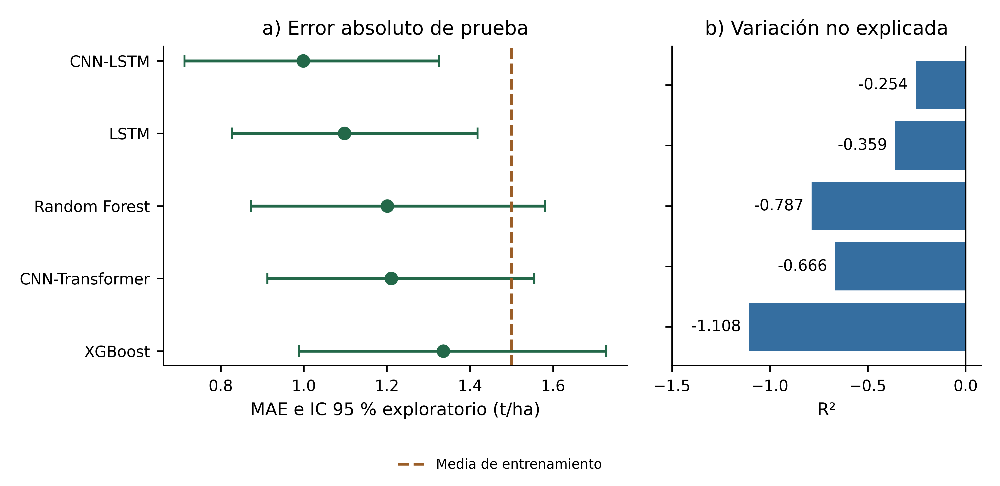
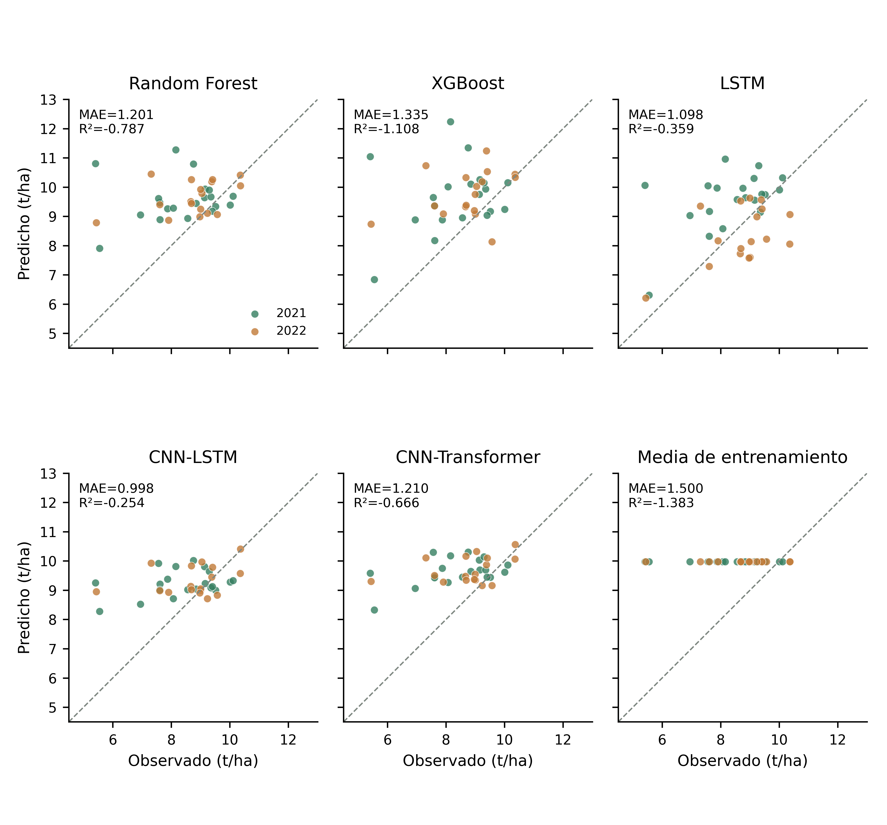
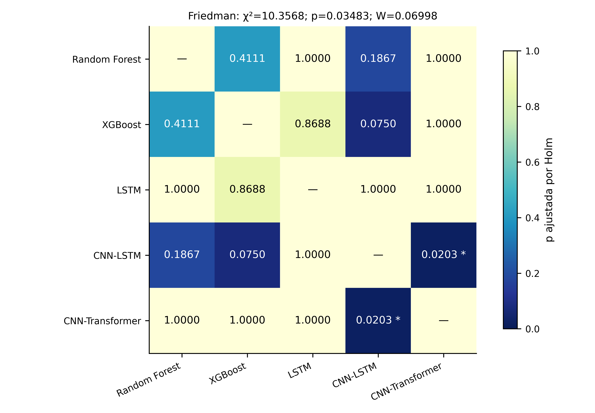
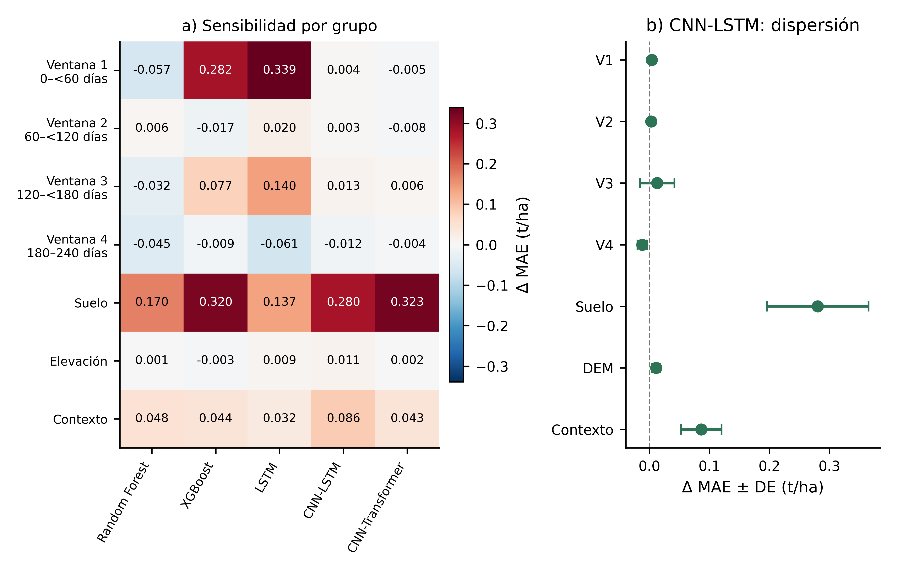

# Evaluación temporal del rendimiento de trigo con satélite y suelo: piloto reproducible en Alemania

**English title:** Temporal evaluation of wheat yield models using satellite and soil features: a reproducible pilot study in Germany

**Autores:** nombres y autor de correspondencia por completar.

**Afiliación:** Universidad Nacional de Trujillo, Perú. Facultad, departamento y ORCID por confirmar.

## Resumen estructurado

**Contexto.** La integración de datos de observación terrestre puede apoyar la estimación del rendimiento agrícola, pero la disponibilidad de múltiples variables y de una aplicación funcional no garantiza generalización temporal ni independencia de la evaluación.

**Objetivo.** Evaluar un flujo reproducible de predicción retrospectiva del rendimiento de trigo mediante agregados satelitales y suelo, comparando cinco algoritmos y examinando su sensibilidad a grupos de entradas.

**Métodos.** Se utilizaron 184 registros de trigo de Alemania, derivados de YieldSAT, tras excluir cuatro de 188 candidatos por fechas de siembra dependientes de la cosecha. Se agregaron 12 bandas ópticas en cuatro ventanas hasta 240 días después de la siembra, propiedades superficiales del suelo y elevación, con 113 entradas por registro. Se reservaron 132 registros de 2016–2019 para entrenamiento, 15 de 2020 para validación y 37 de 2021–2022 para prueba. Se evaluaron Random Forest, XGBoost, LSTM, CNN-LSTM y CNN-Transformer, una referencia constante, contrastes pareados exploratorios e interpretabilidad por permutación agrupada.

**Resultados.** CNN-LSTM presentó el menor MAE observado en prueba (0,998 t/ha), RMSE de 1,380 t/ha y R² de −0,254. La referencia de media de entrenamiento obtuvo MAE de 1,500 y RMSE de 1,902 t/ha. Los cinco modelos tuvieron R² negativo. Friedman produjo χ²(4)=10,3568, p aproximada=0,03483 y W=0,06998; únicamente CNN-LSTM frente a CNN-Transformer cruzó el umbral ajustado por Holm (p=0,02026). En validación, permutar suelo aumentó el MAE de CNN-LSTM en 0,280±0,085 t/ha. Treinta y seis de los 37 registros de prueba pertenecían a una misma granja.

**Conclusión.** El sistema permite una evaluación trazable y una consulta histórica funcional, pero los resultados no acreditan capacidad predictiva suficiente ni transferencia espacial. El perfil no integra todavía clima verificado y no permite atribuir mejoras a una fusión completa satélite–clima–suelo.

**Palabras clave:** observación de la Tierra; validación cronológica; cambio de distribución; regresión supervisada; permutación agrupada; reproducibilidad computacional.

## Structured abstract

**Background.** Multisource Earth observation can support crop yield modelling, but functional deployment and numerous predictors do not establish temporal generalization.

**Objective.** To assess a reproducible retrospective wheat-yield pipeline using satellite and soil aggregates, five algorithms, and grouped permutation analysis.

**Methods.** We analysed 184 German wheat records from YieldSAT after excluding four records whose sowing dates depended on harvest dates. Twelve optical bands were aggregated into four windows ending 240 days after sowing and combined with soil, elevation and contextual features. Training comprised 132 records from 2016–2019, validation 15 from 2020, and testing 37 from 2021–2022. Random Forest, XGBoost, LSTM, CNN-LSTM and CNN-Transformer were compared with a training-mean baseline. Statistical comparisons and identifier-level bootstrap intervals were exploratory. Grouped permutation used validation records only.

**Results.** CNN-LSTM achieved the lowest observed test MAE (0.998 t/ha), with RMSE=1.380 t/ha and R²=−0.254, compared with baseline MAE=1.500 and RMSE=1.902 t/ha. All five test R² values were negative. Friedman yielded χ²(4)=10.3568, approximate p=0.03483, and W=0.06998; only CNN-LSTM versus CNN-Transformer crossed the Holm-adjusted threshold (p=0.02026). Soil permutation increased CNN-LSTM validation MAE by 0.280±0.085 t/ha. One farm contributed 36 of 37 test records.

**Conclusions.** Traceable deployment was achieved, whereas reliable predictive performance and spatial transfer remain unestablished. Climate integration, independent-farm evaluation and stronger experimental replication are required before operational claims.

**Keywords:** Earth observation; chronological validation; distribution shift; supervised regression; grouped permutation; computational reproducibility.

## 1. Introducción

Estimar el rendimiento antes de la cosecha es una tarea de regresión cuya utilidad depende de la anticipación de las observaciones y del contexto en que se evalúa el modelo. Una predicción obtenida con datos de toda la campaña responde a una pregunta diferente de una emitida con información disponible en una fecha anterior. Del mismo modo, un error regional no es intercambiable con un error por parcela o píxel. Estas diferencias de escala y disponibilidad condicionan qué comparaciones pueden defenderse científicamente.

Los benchmarks recientes hacen posible estudiar estas condiciones con datos documentados. YieldSAT combina mapas de rendimiento y observaciones ambientales para múltiples cultivos y países y señala desafíos de cambio de distribución (Miranda et al., 2026). CY-Bench organiza la predicción a escala subnacional y proporciona un marco complementario para comparar modelos y fuentes a esa resolución (Kallenberg et al., 2026). Sus poblaciones y unidades analíticas son distintas; disponer de ambos en una plataforma no autoriza a combinar sus métricas como una única evidencia de generalización.

La literatura incluye modelos de fusión temprana de imágenes, clima, suelo y elevación, así como arquitecturas que combinan convolución y recurrencia. Pathak et al. (2023) muestran que la utilidad de las modalidades depende del cultivo, región y modelo; Khaki et al. (2020) ilustran una arquitectura CNN-RNN para rendimiento agrícola. Estos antecedentes justifican examinar diferentes familias de modelos, pero no anticipan cuál funcionará mejor en una cohorte pequeña, agregada por registro y evaluada en campañas posteriores.

La dificultad metodológica no se reduce a elegir una red. Si existe dependencia temporal, espacial o jerárquica, una partición inadecuada puede distorsionar la evaluación y facilitar asociaciones que no se mantienen al transferir el modelo (Roberts et al., 2017). También es necesario distinguir información disponible en el momento de predicción de variables derivadas del desenlace y registrar los pasos que podrían introducir fuga de información (Kapoor y Narayanan, 2023). Por ello, un sistema reproducible debe vincular datos, transformaciones, particiones y modelos, además de presentar sus errores.

En este contexto, la brecha abordada es aplicada y delimitada: determinar qué puede sostener un flujo trazable con modelos compactos sobre un subconjunto autorizado de trigo alemán cuando se impone un corte óptico anterior a la cosecha y se reservan campañas futuras. No se propone una arquitectura original ni se afirma resolver la integración completa de clima, satélite y suelo. Se evalúan tres preguntas: P1, ¿superan los cinco modelos una referencia disponible sin covariables?; P2, ¿son consistentes las diferencias de error bajo comparaciones pareadas exploratorias?; y P3, ¿a qué grupos de entradas son sensibles los modelos congelados en validación?

Las contribuciones verificables son un protocolo de selección que excluye siembras dependientes de la cosecha, una evaluación temporal de cinco familias con trazabilidad hasta sus artefactos y una inspección agrupada de sensibilidad acompañada por una aplicación funcional. Se reportan explícitamente resultados negativos, restricciones de independencia y diferencias entre desempeño retrospectivo y uso operativo. El resto del artículo describe datos y métodos, presenta resultados, y discute su validez y las condiciones necesarias para ampliar el estudio.

## 2. Materiales y métodos

### 2.1. Diseño y auditoría de la aplicación

Se desarrolló un estudio cuantitativo, observacional y retrospectivo, con una partición temporal fija. La auditoría revisó las rutas FastAPI y sus modelos de persistencia, el registro e inspección de CSV, el exportador YieldSAT, el preprocesamiento y entrenamiento, las cinco arquitecturas, la inferencia, la estadística, los componentes React y el despliegue Compose. La evidencia provino de los archivos importados y de modelos ya entrenados; no se generaron datos sintéticos para los resultados del artículo.

La aplicación contiene tres servicios locales: PostgreSQL/PostGIS, FastAPI y un frontend React servido mediante Nginx. Los datos tabulares y pesos se conservan en volúmenes persistentes; la interfaz autentica mediante sesión y aplica roles, protección CSRF y auditoría. La figura 1 representa este flujo. La existencia de PostGIS permite almacenar puntos, pero esta evaluación no reconstruye polígonos ni produce mapas intraparcelarios. El asistente visible es una consulta estructurada, no un sistema RAG. No se atribuyen a la implementación Optuna, SHAP, MLflow o flujos de automatización que no se ejecutaron.

**Figura 1. Flujo auditable del experimento y su despliegue.** Flujo de procesamiento y aplicación del piloto de trigo de Alemania. El corte óptico es siembra + 240 días; se excluyen cuatro registros con siembra derivada de cosecha. Las flechas indican flujo de trabajo, no relaciones causales. La evaluación principal reserva 2021–2022.

### 2.2. Fuente, unidad de análisis y elegibilidad

El usuario obtuvo acceso autorizado a YieldSAT y ejecutó el procesamiento del NetCDF alemán en Colab. El archivo completo no se descargó en el equipo de la aplicación: se recibió un CSV pequeño y su manifiesto de procedencia. La inspección inicial identificó 299 registros de campo de dos cultivos, de los cuales 188 eran trigo. La cohorte del estudio incluyó 184 registros y excluyó cuatro cuyas siembras se definían como 290 días antes de la cosecha. Se exigieron fechas coherentes, al menos una observación óptica utilizable y cosecha posterior al corte de 240 días.

La unidad analítica es el registro de campo/campaña del archivo, no cada uno de sus píxeles. Los candidatos de trigo abarcaron 306.843 píxeles fuente; estos no se contabilizaron como muestras independientes del experimento. El rendimiento objetivo es la media de los píxeles fuente del registro. Aunque los identificadores distinguen registros, no se verificó que identifiquen las mismas parcelas físicas entre años. El filtrado que exige cosecha posterior al corte define retrospectivamente una cohorte de ciclos suficientemente largos y puede producir selección; no equivale a reclutar prospectivamente parcelas antes de conocer la cosecha.

El atributo de unidad del objetivo no estaba declarado en el NetCDF auditado. La conversión conservó explícitamente este hecho y adoptó t/ha con atribución al tutorial oficial del proveedor (YieldSAT, s. f.) y a la descripción de datos de rendimiento de Pathak et al. (2023). Esta atribución externa no se presenta como una calibración agronómica independiente de las etiquetas.

La tabla 1 resume la cohorte por campaña y la partición utilizada en el experimento.

**Tabla 1. Cohorte elegible por campaña y partición**

| Campaña | Partición | n | Granjas | Media | DE | Mín. | Máx. |
| --- | --- | --- | --- | --- | --- | --- | --- |
| 2016 | Entrenamiento | 27 | 5 | 10.882 | 1.963 | 5.837 | 14.400 |
| 2017 | Entrenamiento | 28 | 5 | 10.820 | 2.453 | 6.097 | 15.226 |
| 2018 | Entrenamiento | 29 | 4 | 9.203 | 1.711 | 5.096 | 11.814 |
| 2019 | Entrenamiento | 48 | 5 | 9.445 | 1.431 | 4.915 | 12.153 |
| 2020 | Validación | 15 | 4 | 10.072 | 1.659 | 6.632 | 12.716 |
| 2021 | Prueba | 20 | 2 | 8.346 | 1.307 | 5.407 | 10.113 |
| 2022 | Prueba | 17 | 1 | 8.742 | 1.180 | 5.437 | 10.364 |

*Nota.* Rendimiento en t/ha; DE: desviación estándar muestral. Total 184 registros; las granjas se repiten entre campañas. No son 184 parcelas físicas longitudinales verificadas.

### 2.3. Construcción de entradas y disponibilidad temporal

Se utilizaron 12 bandas ópticas y las fechas `times` por píxel. Se admitieron observaciones entre siembra y día 240, ambos incluidos. Los intervalos fueron [0,60), [60,120), [120,180) y [180,240]. En cada intervalo se calcularon medias sobre observaciones píxel-tiempo finitas y un contador por banda normalizado por número de píxeles. Los agregados no son imágenes de entrada de una CNN espacial. Los cuatro intervalos son ventanas cronológicas, no etapas fenológicas verificadas.

Una media sin observaciones se representó con cero y contador cero; por tanto, ese cero no se interpreta como reflectancia medida. Se conservaron seis propiedades superficiales —arcilla, arena, limo, pH, carbono orgánico y nitrógeno— y elevación, cada una con indicador de disponibilidad. Se mantuvieron las unidades fuente sin conversión radiométrica o edáfica inferida. Los siete indicadores estáticos fueron constantes e iguales a uno en la cohorte exportada; no se eliminaron posteriormente porque ello exigiría reentrenar y reevaluar modelos.

Se añadieron cultivo, región/granja y campaña como categorías de contexto, totalizando 110 entradas numéricas y tres categóricas. El cultivo fue constante; conservarlo mantuvo la compatibilidad del esquema. Los identificadores de parcela, fechas de cosecha y el objetivo observado se excluyeron de los predictores. La tabla 2 resume la operacionalización, incluidos los patrones de ventanas vacías.

**Tabla 2. Operacionalización de las 113 entradas**

| Grupo | Variables | Entradas | Disponibilidad | Ventanas vacías B02 |
| --- | --- | --- | --- | --- |
| Ventana 1 | 12 medias de banda + 12 contadores | 24 | 0–<60 días | 23 |
| Ventana 2 | 12 medias de banda + 12 contadores | 24 | 60–<120 días | 75 |
| Ventana 3 | 12 medias de banda + 12 contadores | 24 | 120–<180 días | 14 |
| Ventana 4 | 12 medias de banda + 12 contadores | 24 | 180–240 días | 2 |
| Suelo superficial | Arcilla, arena, limo, pH, SOC, N + indicadores | 12 | Estático, unidades fuente | 0 |
| Elevación | DEM + indicador de disponibilidad | 2 | Estático, unidades fuente | 0 |
| Contexto | Cultivo, región y campaña; one-hot | 3 | Categorías del registro | No aplica |
| Excluidos | Clima, índices calibrados y parches espaciales | 0 | Fuera de este perfil | No aplica |

*Nota.* Los intervalos ópticos usan la variable times por píxel; día 240 incluido. Cero + contador cero representa falta de observación, no reflectancia medida. Los siete indicadores estáticos valen 1 en todos los registros; no se eliminaron ni se reentrenó. No se atribuyen unidades físicas nuevas a los predictores.

La meteorología quedó fuera del perfil porque la agregación y las unidades de los canales entregados no se habían verificado para este análisis. Los valores altos observados no se corrigieron automáticamente ni se interpretaron como temperaturas instantáneas. Tampoco se calcularon NDVI/EVI/NDWI con escalas radiométricas no confirmadas. La documentación previa describe agregación temporal de modalidades (Pathak et al., 2023), pero no sustituye verificar el producto concreto importado. Por ello, el título del estudio menciona satélite y suelo, y no una integración climática completada.

### 2.4. Separación, preprocesamiento y modelos

Las campañas 2016–2019 se asignaron a entrenamiento (n=132), 2020 a validación (n=15) y 2021–2022 a prueba (n=37). No se mezclaron campañas entre particiones. Se utilizó semilla 42. La separación evita intercalado cronológico de campañas, pero no establece independencia espacial ni excluye continuidad física no documentada entre registros.

La imputación por mediana se ajustó exclusivamente con entrenamiento. Las redes emplearon estandarización de variables numéricas; los árboles, variables sin escalado. Las categorías se codificaron con one-hot ajustado en entrenamiento y manejo de categorías desconocidas como vector nulo. Por ello, las categorías de campaña 2020–2022 no se habían observado al ajustar el codificador. Es una propiedad del procedimiento evaluado, no evidencia de que esas campañas deban rechazarse. Su inclusión como categoría se considera una decisión a revisar en un experimento futuro independiente.

Se compararon Random Forest (Breiman, 2001), XGBoost (Chen y Guestrin, 2016), LSTM (Hochreiter y Schmidhuber, 1997) y dos híbridos compactos. CNN-LSTM utiliza convolución temporal seguida de recurrencia; CNN-Transformer aplica convolución temporal y un encoder de atención, inspirándose en componentes de atención descritos por Vaswani et al. (2017). No se afirma replicar la arquitectura completa de ese artículo ni una CNN espacial. La tabla 3 detalla parámetros y tiempos registrados.

**Tabla 3. Configuración de los modelos congelados**

| Modelo | ID | Configuración | Épocas | Tiempo (s) |
| --- | --- | --- | --- | --- |
| Random Forest | 14 | 160 árboles; hoja mínima 2; profundidad sin límite; n_jobs=-1 | No aplica | 1.573 |
| XGBoost | 15 | 180 árboles; profundidad 4; lr=0,05; subsample=0,9; colsample=0,9; hist | No aplica | 0.868 |
| LSTM | 16 | 1 capa LSTM, 32 unidades; último estado + estáticos; MLP 32→1 | 30 | 13.010 |
| CNN-LSTM | 17 | Conv1D 24→32, kernel 3, padding 1; LSTM 32; MLP 32→1 | 30 | 4.657 |
| CNN-Transformer | 18 | Conv1D 24→32; 1 encoder, 4 cabezas, FFN 64, dropout 0,1; media temporal + MLP | 30 | 1.573 |

*Nota.* Redes: entrada 4×24 y 24 estáticos tras codificación; Adam lr=0,003, MSE, minibatch≤64, semilla 42, CPU. Normalización/imputación ajustadas solo en entrenamiento; árboles sin escalado. No hubo Optuna ni parada temprana. Tiempo de una ejecución registrado por el sistema, no benchmark controlado de hardware.

Las tres redes recibieron secuencias de dimensión 4×24 —medias y contadores— y 24 componentes estáticos tras codificación. Se entrenaron 30 épocas fijas mediante Adam, tasa 0,003 y pérdida cuadrática, sin parada temprana ni búsqueda de hiperparámetros. Los árboles utilizaron configuraciones fijas. Igualar épocas de redes no iguala presupuesto de optimización entre familias; esta comparación no demuestra el mejor rendimiento alcanzable de cada arquitectura. La referencia constante se ajustó como media del objetivo del entrenamiento, sin utilizar covariables ni etiquetas de prueba para fijar su valor.

### 2.5. Métricas, contrastes e incertidumbre

Se calcularon MAE=(1/n)Σ|yᵢ−ŷᵢ|, RMSE=√[(1/n)Σ(yᵢ−ŷᵢ)²], R²=1−Σ(yᵢ−ŷᵢ)²/Σ(yᵢ−ȳ)² y MAPE=100·(1/n)Σ|(yᵢ−ŷᵢ)/yᵢ|. MAPE solo se informa cuando ningún objetivo se aproxima a cero; esta condición se cumplió en prueba. MAE y RMSE se expresan en t/ha. Un R² negativo indica mayor error cuadrático que una constante igual a la media de prueba calculada retrospectivamente; esa constante no es un predictor disponible de antemano.

Se construyó una matriz pareada de MAE por identificador para los cinco modelos. En este piloto cada identificador tiene una observación, por lo que la pérdida por bloque coincide con su error absoluto. Friedman compara los rangos de estas pérdidas y se acompaña por W=χ²/[N(k−1)], con N=37 y k=5 (Friedman, 1937). Se conserva la p de la aproximación χ² de SciPy. Su documentación recomienda cautela con pocos modelos (SciPy, s. f.); no se obtuvo una p exacta o por permutaciones.

Se realizaron diez Wilcoxon bilaterales sobre diferencias pareadas, utilizando `zero_method=wilcox` y `method=auto`, y se ajustó toda la familia mediante Holm, con α=0,05 (Wilcoxon, 1945; Holm, 1979). La hipótesis de simetría de las diferencias y la independencia entre bloques no se declararon demostradas. Los intervalos del MAE se calcularon mediante 2.000 remuestreos de identificadores completos, con reemplazo y semilla 42, y percentiles 2,5/97,5; son una aplicación local de remuestreo bootstrap (Efron, 1979), no intervalos individuales de rendimiento ni intervalos BCa.

Estos análisis son exploratorios. Los registros de una granja pueden depender entre sí, y el bootstrap por identificador no modela esa jerarquía. Con solo dos granjas en prueba no se propone una inferencia confirmatoria por granja. No se aplicaron McNemar o DeLong, correspondientes a clasificación/ROC, ni Diebold-Mariano sin un protocolo temporal de pronósticos y dependencia serial adecuado.

### 2.6. Interpretabilidad agrupada posterior

Se examinó sensibilidad por permutación de siete grupos: cuatro ventanas ópticas con sus contadores, suelo, elevación y contexto. Cada grupo se permutó conjuntamente entre los 15 registros de validación, manteniendo intactos los otros grupos, el objetivo y los pesos. Para cada grupo/modelo se realizaron 30 permutaciones con semilla 20261106 y se calculó ΔMAE=MAE permutado−MAE original. Las mismas permutaciones se utilizaron en cada combinación para facilitar comparación descriptiva.

Se informa media y desviación estándar de esas perturbaciones. No se ajustó una prueba de significación de importancia ni se implementó el procedimiento de corrección PIMP de Altmann et al. (2010); se toma su discusión de interpretabilidad como antecedente, distinguiendo el procedimiento empleado. Tampoco se calculó SHAP. Permutar conjuntamente preserva relaciones internas del grupo, pero puede romper relaciones entre grupos y producir combinaciones poco representativas. Los resultados describen dependencia del modelo y no efectos causales del suelo o de una ventana fenológica.

El análisis se realizó después de congelar y evaluar los modelos, y no se utilizó para modificar variables, hiperparámetros o particiones. La prueba se había inspeccionado previamente; el estudio no es prerregistrado ni una evaluación de prueba ciega. Esta transparencia evita presentar la interpretabilidad posterior como evidencia independiente de confirmación.

### 2.7. Reproducibilidad, versiones y verificación

Cada artefacto dispone de un hash del CSV, semilla, partición y esquema de variables. El CSV del estudio tiene SHA-256 `fa9496d9598896042152d3bd669edd1290384630f0e880d79fdde483aee0e2e1`. Se verificó correspondencia con el manifiesto recibido y con los modelos 14–18 del dataset 9. El hash del NetCDF proviene del recibo remoto; no se recomputó sobre el archivo grande en el equipo local.

La inferencia completa y las métricas se recuperaron de los modelos congelados, sin reentrenamiento, y coincidieron con los registros persistidos con tolerancia numérica inferior a 10⁻⁶ en MAE. Se documentaron Python, NumPy, pandas, scikit-learn, XGBoost, SciPy y PyTorch en la evidencia complementaria. Las versiones auditadas incluyeron scikit-learn 1.6.0, XGBoost CPU 3.4.1, PyTorch 2.15.0+cpu y SciPy 1.18.1. Los segundos de entrenamiento proceden de una ejecución local y no controlan carga o hardware; no deben utilizarse como un benchmark de eficiencia.

## 3. Resultados

### 3.1. Cohorte y estructura de dependencia

Los 184 registros elegibles abarcaron siete campañas y cinco granjas. Farm2 aportó 124 registros, farm1 44, farm3 y farm4 cinco cada una, y farm6 seis. Los cuatro excluidos pertenecían a farm5. La tabla 1 y la figura 2 muestran la distribución temporal y espacial. La prueba contiene 20 registros de 2021 y 17 de 2022; 36/37 proceden de farm2. Por tanto, el número de registros de prueba no puede equipararse a 37 unidades espaciales independientes verificadas.

**Figura 2. Composición de la cohorte y desplazamiento del objetivo.** Distribución de los 184 registros por campaña (a), granja y partición (b), y rendimiento observado (c). Entrenamiento n=132, validación n=15 y prueba n=37. Las cajas muestran mediana y rango intercuartílico; bigotes de Tukey (1,5 RIC). En prueba, 36 registros son de farm2 y uno de farm6.

El rendimiento medio fue 9,977±1,980 t/ha en entrenamiento, 10,072±1,659 en validación y 8,528±1,249 en prueba. No se atribuye esta diferencia a clima o manejo: el diseño no identifica ese mecanismo. Las ventanas ópticas vacías de B02 afectaron a 23, 75, 14 y dos registros, respectivamente. Los contadores hicieron explícita esta disponibilidad desigual sin rellenar observaciones futuras.

### 3.2. Desempeño de los cinco modelos y referencia

Los cinco modelos presentaron menor MAE y RMSE de prueba que la referencia de media de entrenamiento. CNN-LSTM tuvo el menor MAE de prueba observado, mientras que CNN-Transformer obtuvo el menor MAE de validación. La tabla 4 evita confundir estos dos criterios y la figura 3 muestra el desempeño con su incertidumbre exploratoria. El MAE de CNN-LSTM fue aproximadamente un 33,4 % inferior al de la referencia, pero su R² siguió siendo negativo. Este contraste entre métricas impide interpretar la mejora relativa como prueba suficiente de buena predicción.

**Tabla 4. Validación y desempeño final en los mismos 37 registros de prueba**

| Modelo | MAE val. | MAE prueba | IC 95 % MAE | RMSE prueba | R² prueba | MAPE % |
| --- | --- | --- | --- | --- | --- | --- |
| Random Forest | 1.508 | 1.201 | [0.873; 1.581] | 1.647 | -0.787 | 16.51 |
| XGBoost | 1.078 | 1.335 | [0.988; 1.728] | 1.789 | -1.108 | 17.83 |
| LSTM | 1.207 | 1.098 | [0.827; 1.418] | 1.437 | -0.359 | 14.08 |
| CNN-LSTM | 1.151 | 0.998 | [0.713; 1.325] | 1.380 | -0.254 | 13.85 |
| CNN-Transformer | 1.020 | 1.210 | [0.912; 1.555] | 1.590 | -0.666 | 16.63 |
| Media de entrenamiento | 1.207 | 1.500 | No estimado | 1.902 | -1.383 | 20.56 |

*Nota.* MAE/RMSE/IC en t/ha. IC exploratorios por identificador (2.000 remuestreos), sin corrección por granja. La referencia usa únicamente la media de entrenamiento. El menor MAE de validación corresponde a CNN-Transformer; el menor MAE de prueba, observado a posteriori, a CNN-LSTM.

**Figura 3. Precisión descriptiva e incertidumbre del MAE.** MAE de los cinco modelos en 37 registros de 2021–2022, con intervalos percentiles del 95 % mediante 2.000 remuestreos de identificadores (a), y R² sobre los mismos registros (b). La referencia predice la media del entrenamiento (9,977 t/ha; MAE de prueba 1,500 t/ha). Los intervalos no incorporan dependencia dentro de granja.

La figura 4 compara predicciones individuales con el objetivo en una escala común. Varios modelos concentran sus salidas en un intervalo más estrecho que el objetivo de prueba, sin capturar adecuadamente sus extremos. XGBoost mostró MAE de entrenamiento de 0,056 t/ha frente a 1,335 t/ha en prueba; esa separación entre ajuste y evaluación ilustra que un error de entrenamiento muy bajo no acredita generalización.

**Figura 4. Concordancia entre rendimientos observados y predichos.** Predicciones congeladas de los cinco modelos y la referencia constante para los mismos 37 registros de prueba. Cada punto es un registro, coloreado por campaña; la línea discontinua representa identidad. Los ejes comparten la misma escala para evitar comparaciones visuales engañosas.

Si se fijara selección exclusivamente por MAE de validación, se elegiría CNN-Transformer, cuyo MAE final fue 1,210 t/ha. Por ello, presentar CNN-LSTM como ganador del ensayo es una descripción posterior de este conjunto de prueba, no una estimación no sesgada del rendimiento de un procedimiento de selección ni una recomendación operativa universal.

### 3.3. Comparaciones pareadas

Friedman produjo χ²(4)=10,3568 y p aproximada=0,03483, con W=0,06998. La magnitud de W muestra una separación reducida de los rangos frente al máximo posible. Tras ajustar las diez parejas, únicamente CNN-LSTM frente a CNN-Transformer cruzó el umbral de 0,05 (p Holm=0,02026). No lo hicieron Random Forest frente a CNN-LSTM (0,18669) ni XGBoost frente a CNN-LSTM (0,07502). Las comparaciones no significativas se mantienen en la tabla 5 y la figura 5; no se interpretan como equivalencia.

**Tabla 5. Comparaciones Wilcoxon bilaterales y ajuste de Holm**

| Pareja A / B | Mediana Δ MAE | p original | p Holm | p Holm<0,05 |
| --- | --- | --- | --- | --- |
| Random Forest / XGBoost | -0.1414 | 0.05873 | 0.41111 | No |
| Random Forest / LSTM | 0.0244 | 0.54054 | 1.00000 | No |
| Random Forest / CNN-LSTM | 0.2434 | 0.02334 | 0.18669 | No |
| Random Forest / CNN-Transformer | 0.0335 | 0.64378 | 1.00000 | No |
| XGBoost / LSTM | 0.1292 | 0.14480 | 0.86882 | No |
| XGBoost / CNN-LSTM | 0.3157 | 0.00834 | 0.07502 | No |
| XGBoost / CNN-Transformer | 0.0044 | 0.38591 | 1.00000 | No |
| LSTM / CNN-LSTM | 0.1251 | 0.28778 | 1.00000 | No |
| LSTM / CNN-Transformer | -0.0342 | 0.57065 | 1.00000 | No |
| CNN-LSTM / CNN-Transformer | -0.3404 | 0.00203 | 0.02026 | Sí |

*Nota.* Δ=error absoluto A−B en t/ha; negativo favorece A en la mediana. Familia de diez comparaciones. Friedman χ²(4)=10,3568; p≈0,03483; W=0,06998. Valores exploratorios, sujetos a dependencia por granja y aproximación asintótica; no prueban equivalencia ni superioridad universal.

**Figura 5. Contrastes pareados y corrección por multiplicidad.** Valores p de diez contrastes Wilcoxon bilaterales sobre errores absolutos por identificador, ajustados por Holm como una sola familia. El asterisco indica p ajustada <0,05. Friedman se calculó sobre la matriz de pérdidas de los mismos 37 identificadores, con aproximación χ² y cuatro grados de libertad.

El intervalo percentil del MAE de CNN-LSTM fue [0,713;1,325] t/ha. La cifra cuantifica variación bajo remuestreo de identificadores de esta muestra, pero no incorpora la dependencia de múltiples registros dentro de farm2. No se utilizan estos valores p o intervalos para afirmar superioridad confirmatoria o validez en granjas nuevas.

### 3.4. Sensibilidad de los modelos a grupos de entradas

La tabla 6 y la figura 6 muestran cambios del MAE bajo perturbaciones en validación. Para CNN-LSTM, suelo produjo ΔMAE=0,280±0,085 t/ha, frente a cambios próximos a cero para las ventanas ópticas. CNN-Transformer presentó ΔMAE de suelo de 0,323±0,085; Random Forest, de 0,170±0,114. LSTM respondió más a la primera ventana óptica (0,339±0,140). La respuesta no fue homogénea entre arquitecturas.

**Tabla 6. Sensibilidad agrupada: cambio del MAE en validación**

| Grupo | Random Forest | XGBoost | LSTM | CNN-LSTM | CNN-Transformer |
| --- | --- | --- | --- | --- | --- |
| Ventana 1 0–<60 días | -0.0567 ± 0.2093 | 0.2817 ± 0.1942 | 0.3386 ± 0.1401 | 0.0039 ± 0.0017 | -0.0049 ± 0.0054 |
| Ventana 2 60–<120 días | 0.0061 ± 0.0240 | -0.0166 ± 0.0346 | 0.0203 ± 0.0618 | 0.0029 ± 0.0025 | -0.0078 ± 0.0073 |
| Ventana 3 120–<180 días | -0.0319 ± 0.0541 | 0.0773 ± 0.0640 | 0.1401 ± 0.0685 | 0.0130 ± 0.0286 | 0.0060 ± 0.0062 |
| Ventana 4 180–240 días | -0.0445 ± 0.0317 | -0.0088 ± 0.0818 | -0.0613 ± 0.0551 | -0.0117 ± 0.0082 | -0.0042 ± 0.0043 |
| Suelo | 0.1699 ± 0.1143 | 0.3199 ± 0.1785 | 0.1373 ± 0.0774 | 0.2803 ± 0.0847 | 0.3234 ± 0.0850 |
| Elevación | 0.0014 ± 0.0152 | -0.0030 ± 0.0029 | 0.0092 ± 0.0066 | 0.0112 ± 0.0070 | 0.0016 ± 0.0014 |
| Contexto | 0.0480 ± 0.0215 | 0.0440 ± 0.0268 | 0.0316 ± 0.0281 | 0.0864 ± 0.0339 | 0.0434 ± 0.0289 |

*Nota.* Media ± DE de 30 permutaciones, n=15 (2020), t/ha; semilla 20261106. No son IC ni valores p. Un Δ positivo indica deterioro al permutar el grupo; un Δ negativo indica mejora bajo esa perturbación. Interpretabilidad posterior, no causal ni SHAP; todos los modelos permanecen congelados.

**Figura 6. Interpretabilidad mediante permutación agrupada en validación.** Cambio medio del MAE al permutar conjuntamente cada grupo de entradas en los 15 registros de validación de 2020. Se usan 30 permutaciones con semilla 20261106, iguales para cada modelo/grupo. Panel a: medias de cinco modelos; panel b: media ± desviación estándar de CNN-LSTM. Los grupos V1–V4 incluyen bandas y contadores por ventana; Suelo incluye seis propiedades y sus indicadores; Contexto incluye cultivo, región y campaña.

Los valores negativos de algunas ventanas indican que, en estas perturbaciones y registros, el error disminuyó al romper su asociación con el resto de entradas. No demuestran que la ventana carezca de información en general, ni justifican eliminarla sin reentrenamiento y otra evaluación. El contexto combina cultivo, región y campaña: las variables constantes no aportan variación a la permutación, y este análisis agrupado no permite asignar su resultado a cada categoría por separado.

### 3.5. Funcionamiento del prototipo

El sistema registró el CSV real, entrenó y persistió los cinco modelos, y permitió recuperar automáticamente las 113 entradas al seleccionar campaña y parcela. Las estimaciones quedaron vinculadas al registro y muestran si proviene de entrenamiento, validación o prueba. El módulo estadístico recupera comparaciones y versiones compatibles, y el módulo de figuras permite consultar representaciones, notas interpretativas y archivos originales a 600 dpi. Este resultado acredita integración de software y trazabilidad; no se interpreta como prueba de precisión agronómica, disponibilidad permanente del servicio ni aceptación editorial.

## 4. Discusión

### 4.1. Respuesta a las preguntas y comparación con antecedentes

La respuesta a P1 es limitada: los cinco modelos superaron la constante ajustada en entrenamiento, pero ninguno obtuvo R² positivo en prueba. La respuesta a P2 es exploratoria: la diferencia global cruza un umbral nominal, la separación de rangos es pequeña y solo una pareja cruza el ajuste de multiplicidad. P3 identifica sensibilidad al grupo de suelo en varias arquitecturas y respuestas temporales heterogéneas. En conjunto, el estudio demuestra un experimento y un servicio trazables, no una solución predictiva madura.

El antecedente de Pathak et al. (2023) informa resultados con múltiples modalidades y evaluación agrupada en campos. Este piloto tiene un corte explícito, agrega píxeles en ventanas, no usa clima y reserva campañas posteriores. Por ello, no se confrontan sus métricas como si fueran resultados sobre la misma tarea. La diferencia entre unidades y estrategias de validación también impide interpretar los experimentos regionales de CY-Bench, disponibles en la aplicación, como validación externa de los modelos YieldSAT (Kallenberg et al., 2026).

Las arquitecturas de recurrencia y atención ofrecen capacidad de representación, pero esa capacidad no elimina restricciones de muestra, observación o evaluación. Los componentes LSTM y atención tienen antecedentes metodológicos sólidos (Hochreiter y Schmidhuber, 1997; Vaswani et al., 2017); este trabajo no demuestra que una arquitectura compacta con cuatro ventanas explote su potencial. La falta de búsqueda de hiperparámetros y repetición entre semillas impide atribuir el resultado a la familia de modelos en general.

### 4.2. Interpretación del error y dependencia del suelo

El desplazamiento del rendimiento entre entrenamiento y prueba ayuda a explicar por qué mejorar una referencia de entrenamiento puede coexistir con R² negativo, pero no establece su causa. La media de prueba representa un comparador retrospectivo distinto de una constante que pueda fijarse antes de la campaña. Informar ambos marcos evita escoger una sola métrica para presentar una imagen favorable del desempeño.

La sensibilidad al suelo merece una lectura igualmente restringida. El grupo incluye variables espacialmente estructuradas que pueden funcionar como sustitutos de granja o región. Su perturbación altera simultáneamente varias relaciones y puede producir entradas fuera de la distribución observada. En consecuencia, un ΔMAE positivo no estima cuánto aumentaría el rendimiento si se modificara una propiedad edáfica. La figura de interpretabilidad hace visible una dependencia computacional y una hipótesis para análisis posteriores, no una recomendación de manejo.

La diversidad entre LSTM y los híbridos también sugiere que no debe equipararse una arquitectura temporal con aprendizaje de fenología. Los conteos de disponibilidad, ceros emparejados y ventanas fijas pueden influir en la representación tanto como la señal espectral. Evaluar ventanas, suelo y contexto mediante ablaciones entrenadas de nuevo, dentro de un protocolo interno, sería necesario para investigar contribución incremental; no se realizó aquí.

### 4.3. Validez, sesgos y alcance de las conclusiones

La validez interna se apoya en el corte óptico, la exclusión de siembras derivadas del futuro, el ajuste del preprocesamiento solo con entrenamiento y la comprobación de artefactos. Sin embargo, la elegibilidad condicionada a cosecha posterior al corte sigue siendo retrospectiva; el preprocesamiento fuente y sus máscaras no fueron reconstruidos desde imágenes originales. Tampoco se verificó identidad física longitudinal. Estas condiciones impiden describir el flujo como libre de todo sesgo o como una evaluación prospectiva certificada (Kapoor y Narayanan, 2023).

La validez externa es especialmente débil: una única región nacional, un cultivo y dos granjas en prueba, con gran concentración en una de ellas. El diseño separa años, pero no responde de forma suficiente a la transferencia entre productores o territorios que motiva la recomendación de validación estructurada (Roberts et al., 2017). No aporta evidencia local peruana. La afiliación de los autores en Perú no modifica el dominio de los datos.

La validez de constructo está condicionada por el objetivo como media de píxeles y por el uso de t/ha atribuido externamente, no confirmado en el atributo NetCDF. Las ventanas no son fenofases y las bandas sin calibración adicional no permiten afirmar uso de índices verificados. Finalmente, la validez de conclusión estadística está limitada por dependencia, tamaño efectivo desconocido, aproximación de Friedman con cinco modelos y una sola ejecución. No se equipara significación con relevancia agrícola.

### 4.4. Implicaciones y extensión prioritaria

La principal implicación técnica es que un servicio puede ser funcional y reproducible aun cuando sus modelos no alcancen precisión adecuada. Hacer visibles las limitaciones evita que una salida numérica de la interfaz se confunda con un pronóstico validado. El acceso a tablas, figuras y versiones facilita revisión de evidencia y detección de inconsistencias, sin que esa trazabilidad sustituya el diseño experimental.

La extensión prioritaria es incorporar más granjas con separación espacial explícita y verificar la identidad de las parcelas entre campañas. Después corresponde verificar la meteorología del producto, construir índices con unidades confirmadas y comparar modalidades mediante ablaciones y optimización interna, manteniendo una prueba externa que no haya intervenido en esas decisiones. La validación prospectiva y una muestra peruana serían necesarias antes de plantear transferencia operativa a ese contexto. Son extensiones derivadas de los límites observados, no prestaciones de la versión actual.

## 5. Conclusiones

Se implementó un flujo reproducible para evaluar cinco modelos sobre 184 registros de trigo alemán mediante agregados satelitales, suelo y elevación. La aplicación preservó el vínculo entre datos, particiones, artefactos e inferencia y permitió cargar automáticamente las entradas de un registro histórico.

CNN-LSTM obtuvo el menor MAE de prueba observado (0,998 t/ha), pero los cinco R² fueron negativos; el modelo con menor MAE de validación fue CNN-Transformer. Estos hallazgos no respaldan una declaración de buena generalización ni superioridad de una familia de modelos. La diferencia global exploratoria y una pareja ajustada significativa deben interpretarse junto a una concentración de 36/37 registros de prueba en una granja.

La permutación agrupada identificó dependencia de varios modelos respecto del bloque de suelo, con heterogeneidad temporal entre arquitecturas. No se demostraron causalidad, importancia individual SHAP ni beneficio incremental de la fusión de modalidades. La contribución es un piloto auditable con resultados negativos explícitos y una plataforma para examinarlos; la integración de clima y la validación espacial/prospectiva permanecen pendientes.

## Declaraciones

**Disponibilidad de datos depositados.** El código de la aplicación, la preparación y el análisis está disponible en https://github.com/Pull-H/prediccion-rendimiento-agricola, versión v1.0.0, junto con las versiones del entorno, hiperparámetros, semilla, particiones por índice de fila, resultados agregados, seis tablas y seis figuras. El código propio utiliza licencia MIT, con exclusiones de materiales de terceros. Los datos fuente se solicitan a YieldSAT mediante https://yieldsat.github.io/ y se utilizan conforme a las condiciones del proveedor. El CSV de 184 registros se identifica por SHA-256 fa9496d9598896042152d3bd669edd1290384630f0e880d79fdde483aee0e2e1; los scripts documentan su preparación y permiten repetir el entrenamiento con acceso autorizado. El CSV derivado, la procedencia detallada, las predicciones individuales y los cinco modelos originales con sus preprocesadores se conservan en un paquete local verificado, no depositado públicamente mientras se revisan sus condiciones de redistribución. La reproducción completa requiere acceso autorizado a esos datos y, para comprobar exactamente las predicciones originales, a los artefactos congelados. La versión v1.0.0 está archivada en Zenodo con DOI: https://doi.org/10.5281/zenodo.24022432.

**Ética y privacidad.** El trabajo utiliza datos agrícolas secundarios obtenidos mediante acceso autorizado. No se realizó una intervención con personas. No se dispone de un número de aprobación o exención institucional y no se inventa uno; los autores deberán confirmar los requisitos de su institución y la revista. Las figuras muestran agregados o puntos sin geolocalización de parcelas. Las claves privadas de acceso no se incluyen.

**Financiación y conflictos de interés.** Declaraciones pendientes de confirmación por los autores; no se infiere ausencia de financiación o de conflictos.

**Contribuciones de autoría y correspondencia.** Pendientes de los nombres y responsabilidades de los autores de la Universidad Nacional de Trujillo. La afiliación institucional no acredita por sí sola autoría o aprobación institucional.

**Uso de asistencia computacional.** Se empleó asistencia de inteligencia artificial para auditoría, programación y preparación del borrador. Los autores humanos deben revisar datos, referencias, interpretación y declaraciones y asumir responsabilidad antes de cualquier envío. No se declara una revisión sistemática o búsqueda ejecutada en Scopus/Web of Science: la revisión narrativa consultó fuentes primarias accesibles y registró sus consultas y metadatos.

## Referencias

Altmann, A.; Toloşi, L.; Sander, O.; Lengauer, T. (2010). Permutation importance: a corrected feature importance measure. Bioinformatics, 26(10), 1340-1347. https://doi.org/10.1093/bioinformatics/btq134

Breiman, L. (2001). Random Forests. Machine Learning, 45(1), 5-32. https://doi.org/10.1023/a:1010933404324

Chen, T.; Guestrin, C. (2016). XGBoost: A Scalable Tree Boosting System. Proceedings of the 22nd ACM SIGKDD International Conference on Knowledge Discovery and Data Mining, , 785-794. https://doi.org/10.1145/2939672.2939785

Efron, B. (1979). Bootstrap Methods: Another Look at the Jackknife. The Annals of Statistics, 7(1), 1-26. https://doi.org/10.1214/aos/1176344552

Friedman, M. (1937). The Use of Ranks to Avoid the Assumption of Normality Implicit in the Analysis of Variance. Journal of the American Statistical Association, 32(200), 675-701. https://doi.org/10.1080/01621459.1937.10503522

Hochreiter, S.; Schmidhuber, J. (1997). Long Short-Term Memory. Neural Computation, 9(8), 1735-1780. https://doi.org/10.1162/neco.1997.9.8.1735

Holm, S. (1979). A Simple Sequentially Rejective Multiple Test Procedure. Scandinavian Journal of Statistics, 6(2), 65–70. https://www.jstor.org/stable/4615733

Kallenberg, M.; Paudel, D.; Ofori-Ampofo, S.; Baja, H.; van Bree, R.; Potze, A.; Poudel, P.; Saleh, A.; Anderson, W.; von Bloh, M.; Castellano, A.; Ennaji, O.; Hamed, R.; Laudien, R.; Lee, D.; Luna, I.; Masiliūnas, D.; Meroni, M.; Mutuku, J. M.; …; Athanasiadis, I. N. (2026). CY-Bench: a comprehensive benchmark dataset for sub-national crop yield forecasting. Earth System Science Data, 18(6), 3997-4018. https://doi.org/10.5194/essd-18-3997-2026

Kapoor, S.; Narayanan, A. (2023). Leakage and the reproducibility crisis in machine-learning-based science. Patterns, 4(9), 100804. https://doi.org/10.1016/j.patter.2023.100804

Khaki, S.; Wang, L.; Archontoulis, S. V. (2020). A CNN-RNN Framework for Crop Yield Prediction. Frontiers in Plant Science, 10, artículo 1750. https://doi.org/10.3389/fpls.2019.01750

Miranda, M.; Pathak, D.; Helber, P.; Bischke, B.; Najjar, H.; Mena, F.; Sanchez, C.; Pai, A.; Arenas, D.; Valdenegro-Toro, M.; Charfuelan, M.; Nuske, M.; Dengel, A. (2026). YieldSAT: A Multimodal Benchmark Dataset for High-Resolution Crop Yield Prediction. arXiv, 2604.00940v1 (preprint). https://doi.org/10.48550/arXiv.2604.00940

Pathak, D.; Miranda, M.; Mena, F.; Sanchez, C.; Helber, P.; Bischke, B.; Habelitz, P.; Najjar, H.; Siddamsetty, J.; Arenas, D.; Vollmer, M.; Charfuelan, M.; Nuske, M.; Dengel, A. (2023). Predicting Crop Yield with Machine Learning: An Extensive Analysis of Input Modalities and Models on a Field and Sub-Field Level. IGARSS 2023 - 2023 IEEE International Geoscience and Remote Sensing Symposium, , 2767-2770. https://doi.org/10.1109/igarss52108.2023.10282318

Roberts, D. R.; Bahn, V.; Ciuti, S.; Boyce, M. S.; Elith, J.; Guillera‐Arroita, G.; Hauenstein, S.; Lahoz‐Monfort, J. J.; Schröder, B.; Thuiller, W.; Warton, D. I.; Wintle, B. A.; Hartig, F.; Dormann, C. F. (2017). Cross‐validation strategies for data with temporal, spatial, hierarchical, or phylogenetic structure. Ecography, 40(8), 913-929. https://doi.org/10.1111/ecog.02881

SciPy (s. f.). friedmanchisquare — SciPy reference. Documentación oficial. https://docs.scipy.org/doc/scipy/reference/generated/scipy.stats.friedmanchisquare.html

Vaswani, A.; Shazeer, N.; Parmar, N.; Uszkoreit, J.; Jones, L.; Gomez, A. N.; Kaiser, Ł.; Polosukhin, I. (2017). Attention Is All You Need. Advances in Neural Information Processing Systems, 30. https://proceedings.neurips.cc/paper_files/paper/2017/hash/3f5ee243547dee91fbd053c1c4a845aa-Abstract.html

Wilcoxon, F. (1945). Individual Comparisons by Ranking Methods. Biometrics Bulletin, 1(6), 80–83. https://doi.org/10.2307/3001968

YieldSAT (s. f.). YieldSAT machine learning tutorial. Documentación oficial del proyecto. https://yieldsat.github.io/notebooks/yieldsat-ml-tutorial.html
